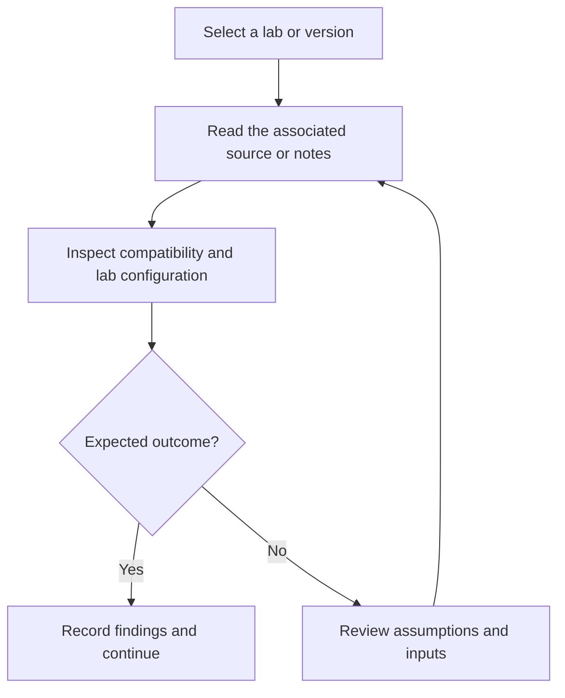

# Networking Appliance and Router Image Archive

Archive of network appliance definitions and router image files for networking lab experiments.

## Project focus

Reference archive / lab resources. Use the directory map to choose a focused example or learning topic instead of treating the repository as one application.

## Workflow



The diagram describes how to work through the material; it is not a deployed service topology.

## Repository structure

| Path | Purpose |
| --- | --- |
| [`Cisco 3660/`](Cisco%203660) | Project-specific source, resources, or learning material. |
| [`Cisco ASA/`](Cisco%20ASA) | Project-specific source, resources, or learning material. |
| [`Cisco IOU L2/`](Cisco%20IOU%20L2) | Project-specific source, resources, or learning material. |
| [`Cisco ISOvL2/`](Cisco%20ISOvL2) | Project-specific source, resources, or learning material. |
| [`Cisco Switches/`](Cisco%20Switches) | Project-specific source, resources, or learning material. |
| [`Linux/`](Linux) | Project-specific source, resources, or learning material. |
| [`cisco-iosv (1).gns3a`](cisco-iosv%20%281%29.gns3a) | GNS3 appliance definition. |
| Binary image files | Router/virtual-appliance resources; obtain and use only images you are entitled to run. |

## Getting started

```bash
git clone https://github.com/Raimal-Raja/Cisco_Appliances_Router_ISO_Images.git
cd Cisco_Appliances_Router_ISO_Images
```

Browse the resource folders and associated notes first. This repository is not a Python web service and does not have a single application launch command.

Use GNS3 with compatible, correctly licensed appliances. Review the saved topology and routing/ACL notes before starting devices.

## Verification

Use the setup commands and inspect the selected interface, example, or notebook with known inputs. This documentation review checks repository paths and dependency declarations; it does not claim fresh end-to-end execution or model-quality measurements.

## Contributing

Include reproduction steps, the affected path, expected behavior, and the checks you ran. Keep credentials, generated environments, and unnecessary build artifacts out of commits.

## License

No top-level license file is currently tracked. Check reuse permissions with the repository owner.
